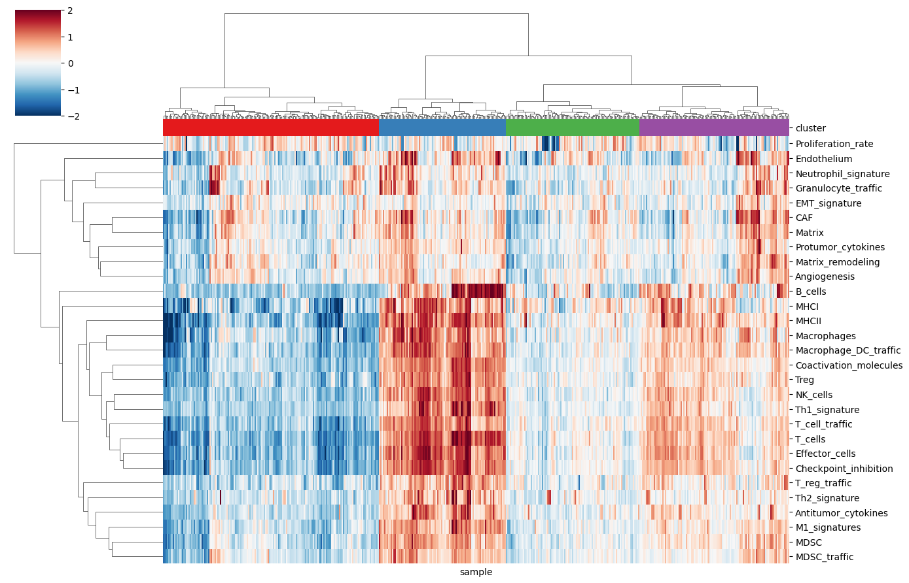
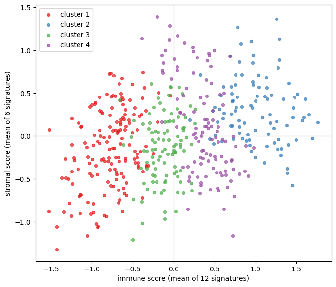
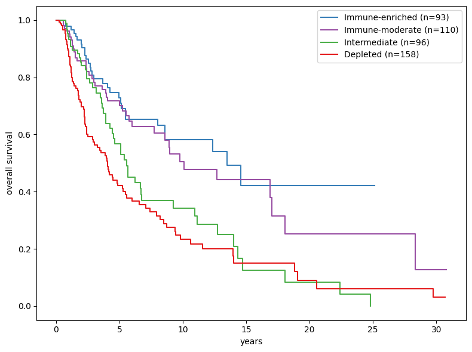

# Immune infiltration in TCGA melanoma: does it predict survival?

I scored 473 melanoma samples from TCGA with the 29 tumor microenvironment gene signatures published by BostonGene, grouped the samples by those scores, and tested whether the groups differ in how long patients lived. They do. Median overall survival runs from 4.0 years in the least infiltrated group to 13.5 years in the most infiltrated one, and the effect holds after adjusting for stage, age, sex and sample type.

What I did not find is the four microenvironment types described in the source paper. In this cohort the samples form a single gradient of infiltration rather than four distinct groups, so that is how I report them.

## Question

The MFP paper (Bagaev et al., Cancer Cell 2021) describes four tumor microenvironment types found across cancers, defined on two axes: how much immune infiltration a tumor has, and how fibrotic it is. I wanted to answer two questions with public data.

1. Do melanomas in TCGA fall into those four types when scored with the published signatures?
2. Do the resulting groups differ in overall survival, and does any difference hold once stage is taken into account?

## Data

Expression: UCSC Xena, `TCGA.SKCM.sampleMap/HiSeqV2`, values are log2(normalized count + 1), 20,530 genes by 474 samples.

Survival and clinical variables: UCSC Xena, `survival/SKCM_survival.txt` and `TCGA.SKCM.sampleMap/SKCM_clinicalMatrix`.

Gene signatures: the 29 signatures from github.com/BostonGene/MFP, file `signatures/gene_signatures.gmt`, published with Bagaev et al. 2021.

Per-sample output of this analysis: `skcm_tme_subtypes.csv` in this repository, with the immune score, stromal score, cluster and group label for every sample.

All inputs were downloaded on 8 November 2026.

### Curation

| Step | Result |
|---|---|
| Samples in the expression matrix | 474 |
| After removing the one normal-tissue sample | 473 tumors |
| Metastatic samples among them | 369 |
| Primary tumor samples among them | 104 |
| Genes listed across the 29 signatures | 257 |
| Not found under their current symbol | 5 |
| Recovered under an older symbol | 2 |
| Genes used for scoring | 254 |
| Samples with overall survival data | 457 |
| Samples with survival and complete clinical data | 411 |

Five signature genes were missing from the Xena matrix. Two are renames and I recovered both: CXCL8 appears under its former symbol IL8, and VSIR under C10orf54. The other three are TRAC, TRBC1 and TRBC2, the constant regions of the T-cell receptor, which are absent from this gene annotation altogether. I dropped them and scored the T_cells signature from its remaining genes.

Of the 457 patients with survival data, 46 were left out of the Cox model below, all of them for a missing pathologic stage. Age and sex are complete. One patient has no recorded sample type and was treated as metastatic by the coding used here, which is a small inaccuracy worth knowing about.

The cohort is mostly metastases, 369 of 473. That is how TCGA SKCM was assembled rather than a choice I made, and it affects the survival results, so it comes up again below.

## Methods

Signature scores. Each gene was z-scored across samples: its mean across the cohort was subtracted and the result divided by its standard deviation. Genes with no variance were dropped. A signature's score for one sample is the mean z of its genes. Scoring this way keeps a signature from being dominated by whichever of its genes happens to be expressed most strongly.

This is a simplification of the published method. The authors use ssGSEA with a formula of their own, documented in their repository. I use their gene lists with a simpler scoring function, so the direction of my scores matches theirs but the values do not.

Grouping. Scores were clipped at plus and minus 2 and clustered with Ward linkage on Euclidean distance. I cut the tree into four groups to match the number of types in the paper. Ward linkage and the tree cut are deterministic, so there is no random seed in this analysis.

Two composite axes. To see whether the groups land in the paper's four quadrants I reduced the signatures to two numbers per sample: the mean of 12 immune signatures (MHCI, MHCII, Coactivation_molecules, Effector_cells, T_cell_traffic, NK_cells, T_cells, B_cells, M1_signatures, Th1_signature, Antitumor_cytokines, Checkpoint_inhibition) and the mean of 6 stromal ones (CAF, Matrix, Matrix_remodeling, Angiogenesis, Endothelium, EMT_signature). That is 18 of the 29 signatures. The remaining 11, which cover regulatory and suppressive populations such as Treg, MDSC, neutrophils and macrophages, are used for the grouping and the heatmap but take no part in either axis. Which signature counts as immune and which as stromal is my own division, not the authors'.

Survival. Kaplan-Meier curves for overall survival with a multivariate log-rank test across the four groups, then a Cox proportional hazards model adjusting for stage, age, sex and sample type. Both from lifelines. Confidence bands are left off the figure so four curves stay readable; numbers at risk are printed underneath instead.

## Results

### The groups form a gradient of infiltration, not four quadrants

| Group | n | Immune score | Stromal score |
|---|---|---|---|
| Low | 163 | -0.78 | -0.16 |
| Intermediate | 101 | -0.11 | -0.15 |
| High | 113 | 0.37 | 0.11 |
| Very high | 96 | 1.00 | 0.30 |

I label the groups by infiltration level on purpose. They are not the published types and should not be read as them.

The groups separate almost entirely along the immune axis. The quadrant that would define the fibrotic type, low immune signal with high stromal signal, is not occupied by any of them. Across samples the two axes are positively correlated (Spearman rho 0.30, p 3e-11), so stromal signal tends to rise together with immune signal rather than varying independently of it. I did not check how common the fibrotic type is in melanoma in the original paper, so I make no claim about whether this cohort is unusual.

The data do not particularly want four groups either. Silhouette scores are highest at the coarsest split and fall from there: 0.30 at two groups, 0.22 at three, 0.14 at four and again at five, then lower still. A low silhouette is what a gradient looks like once you cut it into pieces. I kept four groups for comparison with the paper, and the Cox model below treats infiltration as the continuous quantity it appears to be.

### Survival differs strongly between the groups

| Group | n | Deaths | 5-year survival | Median overall survival | 95% CI of the median |
|---|---|---|---|---|---|
| Low | 158 | 95 | 42% | 4.0 years | 2.9 to 5.2 |
| Intermediate | 96 | 49 | 57% | 5.6 years | 4.2 to 6.8 |
| High | 110 | 41 | 72% | 10.1 years | 7.7 to 17.0 |
| Very high | 93 | 30 | 73% | 13.5 years | 8.0 to not reached |

Multivariate log-rank test across the four groups: p = 1.6e-07.

The ordering of the curves is consistent and the two ends are far apart. The middle of the picture is more subtle than the medians suggest. The two most infiltrated groups are almost identical for the first several years, with five-year survival of 73% and 72%, and they only come apart later, where few patients are still being followed. The upper confidence limit for the median of the Very high group is not reached at all, which is why the numbers at risk are printed under the figure: by year ten that group is down to 20 patients. Treat the 13.5 year median as a rough indication, not a precise estimate.

### The effect holds after adjusting for stage

A log-rank test only says the groups differ. It cannot rule out the obvious alternative, that infiltrated tumors are simply caught earlier. So I fitted a Cox model on the 411 patients with complete clinical data, 191 of whom died, using the immune score as a continuous variable alongside stage, age, sex and sample type. The immune score here is the composite of the 12 immune signatures described above, not any single signature.

| Variable | Hazard ratio | 95% CI | p |
|---|---|---|---|
| Immune score, per standard deviation | 0.63 | 0.54 to 0.74 | 9e-09 |
| Age, per year | 1.02 | 1.01 to 1.03 | <0.001 |
| Male | 1.03 | 0.75 to 1.40 | 0.86 |
| Metastatic sample | 0.42 | 0.26 to 0.68 | <0.001 |
| Stage II (vs stage I) | 1.02 | 0.66 to 1.57 | 0.92 |
| Stage III (vs stage I) | 1.75 | 1.18 to 2.60 | 0.006 |
| Stage IV (vs stage I) | 4.01 | 2.01 to 8.01 | <0.001 |

Concordance 0.70. One standard deviation of the immune score is 0.72 score units.

Stage behaves the way it should, which is a useful check that the model is sensible: stage IV carries four times the risk of stage I and stage III about 1.75 times. Against that background, one standard deviation more immune score cuts the risk of death by about 37%, with a confidence interval well clear of 1. Infiltration is not just a proxy for early stage.

I tested the proportional hazards assumption with the built-in check in lifelines. The immune score passes, as do age, sex, sample type and the other stage terms. Stage III fails it (p = 0.028), meaning its hazard ratio relative to stage I is not constant over the whole follow-up. A fuller treatment would stratify the model on stage III. I left the model as it is and report the failure here, since the variable of interest is unaffected.

The coefficient for metastatic samples is worth saying out loud, because at face value it claims that patients whose sequenced sample was a metastasis died less often than patients whose sample was a primary tumor, which makes no biological sense. The likely explanation is how the cohort was assembled. Survival is counted from the initial diagnosis, but for a metastasis to appear, be resected and be sequenced, the patient had to survive some time past that diagnosis. Patients in that group are long survivors by construction, and their early risk period is never observed. This is left truncation, also called delayed entry: the right fix is a model that accounts for the delayed entry time, which these data do not carry. I report it as the plausible reading rather than a demonstrated one.

The groups are also not evenly distributed across sample types and stages. Primary tumors make up 29% of the Low group but only 13% of the Very high one (chi-square p = 0.009), and stage distribution differs between groups as well (p = 0.03). Both variables are in the Cox model, so the hazard ratio above is adjusted for them, but they are worth knowing when reading the Kaplan-Meier curves, which are not adjusted for anything.

## What this adds up to

In this cohort the answer to the title question is yes, through one axis rather than four types. How heavily a melanoma is infiltrated by immune cells tracks survival strongly, it keeps doing so after stage, age, sex and sample type are accounted for, and the fibrotic dimension that separates two of the published subtypes does not appear here at all.

## Limitations

- Most of the cohort is metastatic disease, 369 samples of 473, so this describes metastatic melanoma more than primary disease.
- Scores are mean z-scores rather than the authors' ssGSEA, so they are not numerically comparable to published MFP scores.
- The number of groups was fixed at four for comparison with the paper. Silhouette scores suggest the data would prefer two.
- Splitting the signatures into immune and stromal sets is my own decision and it determines the two-axis figure directly. Eleven of the 29 signatures appear in neither axis.
- Immune and stromal signals both rise when a sample contains less tumor and more surrounding tissue, so part of their correlation may reflect differences in tumor purity rather than biology. I did not adjust for purity.
- Overall survival counts deaths from any cause and nothing here accounts for treatment. These patients were treated largely before checkpoint inhibitors became standard care, so these curves say nothing about who responds to immunotherapy.
- Medians for the two most infiltrated groups rest on few patients at long follow-up, and the upper confidence limit for the Very high group is not reached.
- A Cox model adjusts only for the variables it is given. Tumor burden, the site of the sampled lesion and treatment are not among them, and the proportional hazards assumption fails for stage III.
- Scores, groups and survival all come from one cohort. Nothing here has been checked against independent data.

## Reproducing

Open `skcm_immune_subtypes.ipynb` in Google Colab and run all cells. It downloads every input file from its public URL, so no manual setup is needed. The analysis has no random component: Ward clustering and the tree cut are deterministic.

The numbers above were produced with lifelines 0.30.3, scikit-learn 1.6.1, scipy 1.16.3 and pandas 2.2.3.
